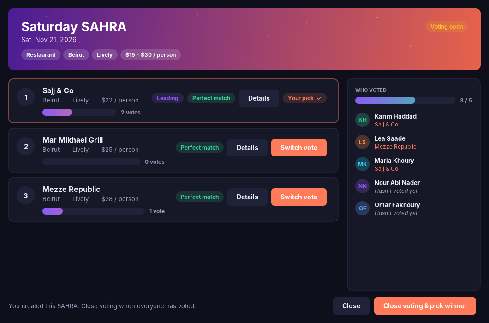
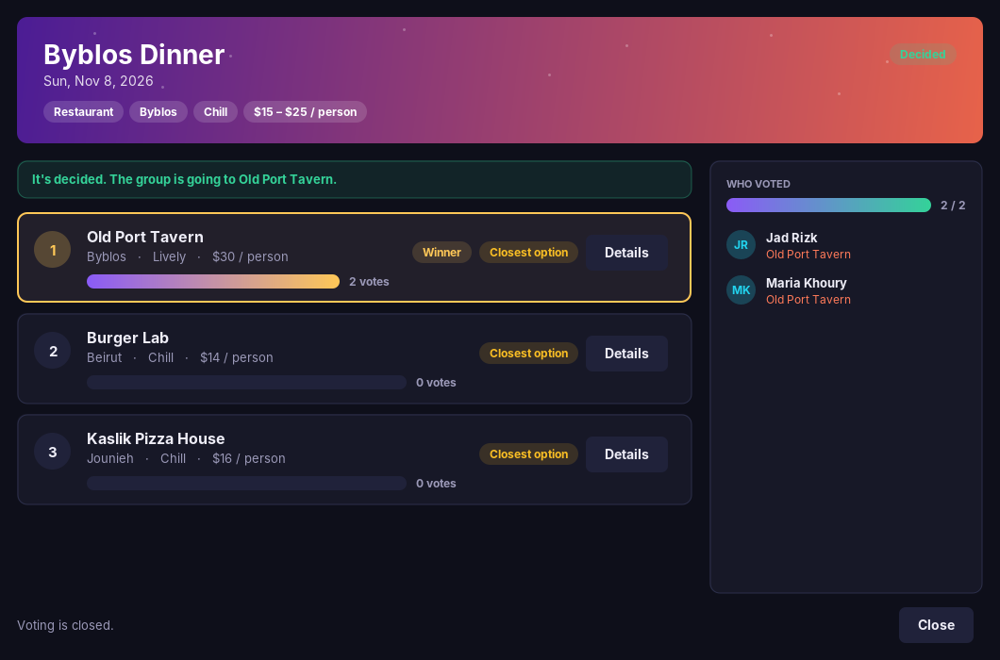
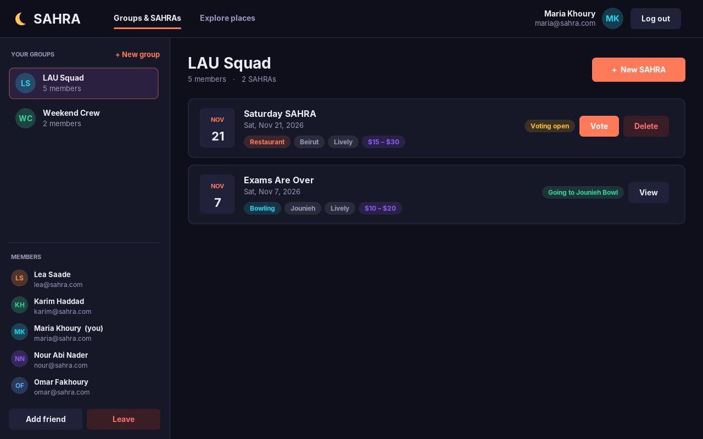
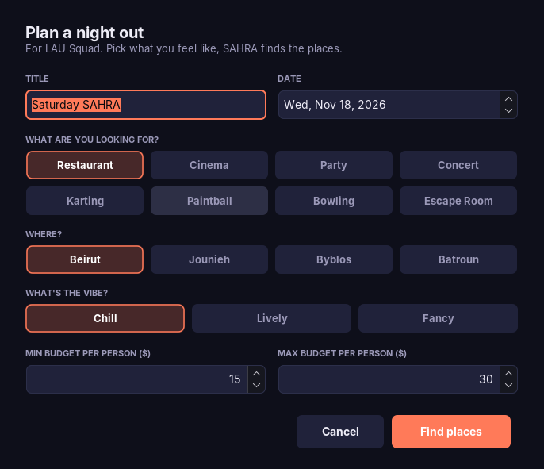
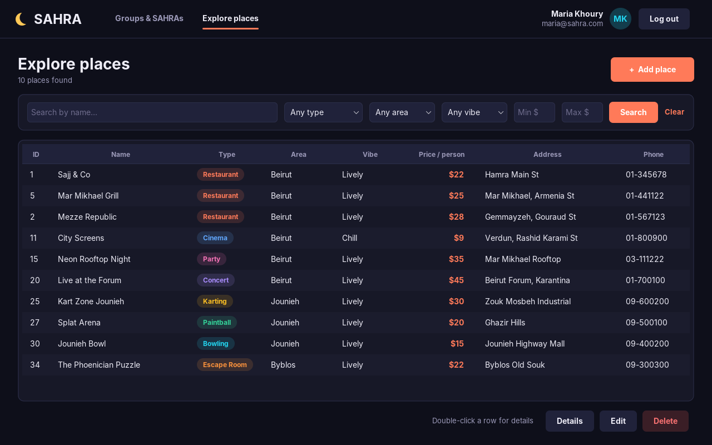
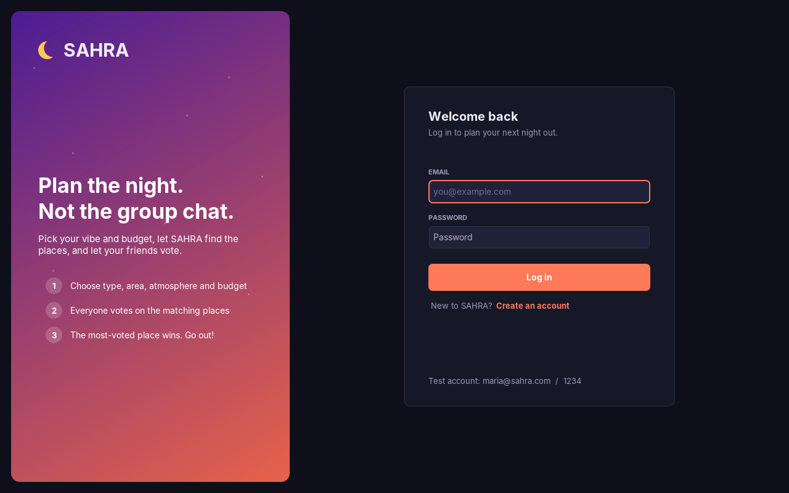

# SAHRA

Every time my friends try to go out, the same thing happens: someone asks "where are we going?", the group chat explodes with 40 suggestions, nobody agrees, and we end up at the same place as last time.

SAHRA is a small desktop app that fixes that. You start a "SAHRA" (night out) with your group, pick what you're in the mood for and how much you want to spend, the app pulls the places that match from the database, and everyone votes. Most votes wins. Done.

Made for **COE 418 – Database Systems** at LAU (Fall 2026).



## What you can do

- Sign up / log in
- Make friend groups and add people by their email
- Plan a SAHRA by picking:
  - **what**: restaurant, cinema, party, concert, karting, paintball, bowling or escape room
  - **where**: Beirut, Jounieh, Byblos or Batroun
  - **the vibe**: chill, lively or fancy
  - **a budget range** per person (e.g. $15 to $30)
- See the places that match and vote. You can change your vote until whoever created the SAHRA closes voting.
- Browse all places, filter them any way you want, and add / edit / delete them.

### When nothing matches

This was the part I cared about most. If you ask for a chill restaurant in Byblos for $15 to $25 and there isn't one, the app doesn't just say "no results". It keeps the type you asked for, tries to stay in the same area, then the same vibe, and ranks what's left by how close the price is to your **minimum** budget. That way the backup options never end up being more expensive than what the group agreed on. These show up as "Closest option" so people know they're not exact matches.



## Screenshots

| Groups and their SAHRAs | Planning a night out |
|---|---|
|  |  |

| Explore places | Login |
|---|---|
|  |  |

## How it's built

- **Java** (17+) with **Swing** for the interface and **FlatLaf** for the dark theme
- **MySQL** for the database, connected with plain **JDBC** (MySQL Connector/J)
- No frameworks. The database code is in a few DAO classes (`src/sahra/db`) that use prepared statements, and the screens are in `src/sahra/ui`.

Since this is a databases course, most of the work went into the schema:

- 15 tables. `activity` is a supertype and each kind of place (restaurant, cinema, party...) has its own subtype table with its own columns, linked 1:1.
- A vote can only point to a place that was actually suggested for that SAHRA. `vote` has a composite foreign key to `event_result(eventID, activityID)`, so this is enforced by the database, not just the app.
- One vote per person per SAHRA: `UNIQUE (eventID, userID)` on `vote`.
- `CHECK` constraints for things like valid areas and vibes, `minBudget <= maxBudget`, no negative prices, and concert tickets going on sale before the concert.
- `ON DELETE CASCADE` where it makes sense (delete a group and its SAHRAs go with it), and the default restrict where history should be kept (you can't delete a place that was already picked as a winner).
- Creating a SAHRA (save it, search, save the results) and voting both run inside transactions.
- Passwords are stored as SHA-256 hashes, not plain text.

`sql/queries.sql` has all the test queries we ran for the report: selections, projections, AND/OR conditions, multi-table joins, GROUP BY / COUNT / HAVING, subqueries, insert/update/delete, and a few that are *supposed* to fail so you can see the constraints doing their job.

```
SAHRA/
├── sql/
│   ├── schema.sql        tables, keys, constraints, a view
│   ├── sample_data.sql   test users, groups, 34 places, 3 SAHRAs
│   └── queries.sql       test queries
├── src/sahra/
│   ├── Main.java
│   ├── db/               JDBC + all the SQL the app runs
│   └── ui/               the screens
├── lib/                  MySQL driver + FlatLaf
└── config.example.properties
```

## Running it yourself

You'll need Java 17 or newer, MySQL 8+ and MySQL Workbench.

1. In MySQL Workbench, open and run `sql/schema.sql`, then `sql/sample_data.sql`.
2. Copy `config.example.properties`, rename the copy to `config.properties`, and put your MySQL password in it. (This file is in `.gitignore`, so your password never gets pushed.)
3. Open the folder in VS Code (with the Java extension pack) and run `src/sahra/Main.java`.

Log in with `maria@sahra.com` / `1234`. All the test accounts use `1234`.

## What I'd add next

- A phone or web version. Realistically that's where people would actually vote.
- Notifying everyone when voting closes
- Making the fallback smarter, e.g. if there's nothing in Byblos, try Jounieh or Batroun before jumping all the way to Beirut
- Reservations straight from the app

The venues in the sample data are made up, and so are their prices.
